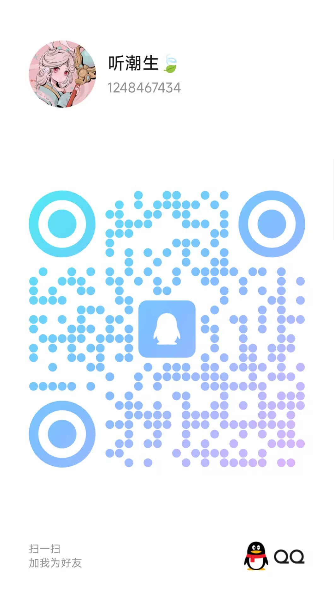

# 影刀社区自动回答系统

本地运行的问题采集 + AI 生成 + 质量闸门 + 人工确认发送工作台。

- 零第三方依赖，只用 Python 标准库
- 数据全部存在本机 `data.db`（SQLite）
- 默认 **演示模式**：不填 API Key 也能跑通全流程，方便先看效果

---

## 目录

- [一、前置条件与启动](#一前置条件与启动)
  - [需要什么](#需要什么)
  - [三步搭起来](#三步搭起来)
  - [首次配置](#首次配置)
- [二、四步流程](#二四步流程)
- [三、接大模型](#三接大模型)
- [四、质检闸门怎么算分](#四质检闸门怎么算分)
- [五、发送：两种方式并存](#五发送两种方式并存)
- [六、数据存在哪里、怎么显示出来的](#六数据存在哪里怎么显示出来的)
- [七、采集接口可配置](#七采集接口可配置)
- [八、响应式](#八响应式)
- [九、文件结构](#九文件结构)
- [十、社区接口默认值（只读，无需登录）](#十社区接口默认值只读无需登录)
- [十一、风险提示](#十一风险提示)
- [联系作者](#联系作者)

## 一、前置条件与启动

### 需要什么

| 项 | 要求 | 说明 |
|---|---|---|
| Python | 3.8 及以上 | 只用标准库，**不需要** `pip install` 任何包 |
| 操作系统 | Windows / macOS / Linux | Windows 自带 `start.bat`；其他系统用 `python3 server.py` |
| 浏览器 | 任意现代浏览器 | 用来打开本机页面 |
| 网络 | 能访问社区接口和大模型接口 | 采集和生成都是外网请求 |
| 大模型 API Key | 任意 OpenAI 兼容服务 | 没有也能跑，但只是演示数据 |
| 社区登录态（可选） | 浏览器 Cookie | 只影响「一键发送」，不填就复制后手动发 |

**不需要**：数据库服务、Docker、Node.js、Nginx、公网域名、服务器。
数据就存本地一个 SQLite 文件，页面由 Python 自带模块提供。

### 三步搭起来

1. **装 Python** — 官网下 3.8+，Windows 安装时记得勾 `Add Python to PATH`
2. **拿代码** — `git clone https://github.com/Cutelisi/yingdao-auto-answer.git`，或直接下载 ZIP 解压
3. **启动** — Windows 双击 `start.bat`；macOS/Linux 执行 `python3 server.py`
   浏览器打开 <http://127.0.0.1:8770>

### 首次配置

1. 右上角「设置」→ 填 Base URL 和 API Key → 点「拉取可用模型」→ 从下拉里选一个 → 保存
2. 需要用「一键发送」再补一次 Cookie（见第五章），不填也能「复制答案」手动发布

## 二、四步流程

| 步骤 | 做什么 | 谁来做 |
|---|---|---|
| 1 采集 | 拉取社区最新提问入库，可按「已解决 / 未解决」筛选、按发布时间排序 | 点右上角「采集最新问题」 |
| 2 生成 | 读取标题、正文、截图和已有回答，让模型写一条可直接发布的答案 | 点「让 AI 生成答案」 |
| 3 质检 | 把答案再交给模型当版主审一遍，同时跑 5 条硬规则，合并算分 | 点「运行质量闸门」 |
| 4 发送 | 你确认内容 → 一键发到社区，或复制后手动发 | 点「一键发送到社区」 |

侧栏视图：**待处理 / 无人回答 / 已生成 / 已发送 / 全部**。

列表上方还有两个筛选：

- **解决状态**：全部 / 只看未解决 / 只看已解决（数据来自社区接口的 `isAccept` 字段）
- **排序**：最新在前 / 最旧在前（按发布时间）

每张卡片左上角有解决状态标记：绿色 `✓ 已解决`、灰色 `未解决`，已解决的卡片左边框也会变绿。底部统计显示「已采集 / 未解决 / 已解决」三个数。

## 三、接大模型

设置面板填 **Base URL + API Key**，然后点「拉取可用模型」——程序会直接调 `GET /v1/models` 把你这把 Key 真正能用的模型列出来，下拉选一个就行，不用记模型名。

| 服务 | Base URL |
|---|---|
| DeepSeek | `https://api.deepseek.com/v1` |
| 通义千问 | `https://dashscope.aliyuncs.com/compatible-mode/v1` |
| Kimi | `https://api.moonshot.cn/v1` |
| 智谱 | `https://open.bigmodel.cn/api/paas/v4` |

如果拉不到列表（Key 无效、网关不支持），会回退成该服务商的常见模型清单，也可以点「模型不在列表里？手动填写」自己输入。

**温度**用滑块调，含义是「答案的随机程度」：

| 区间 | 效果 | 建议 |
|---|---|---|
| 0 – 0.2 | 几乎每次都一样，最稳 | 要严格遵守事实时用 |
| 0.3 – 0.5 | 稳定 + 措辞自然 | **技术问答推荐，默认 0.4** |
| 0.6 – 0.8 | 更灵活，说法多变，偶尔跑偏 | 写文案可以，答疑不建议 |
| 0.9 – 1.0 | 发散，容易编 | 不要用在这里 |

Key 只写在本机 `config.json`，前端只拿到打码后的值。

## 四、质检闸门怎么算分

两层合并：

1. **模型评审**：以版主视角打 0-100 分，输出 `score / verdict / issues / suggestion`
2. **硬规则**（代码层，每条不通过扣 12 分）
   - 篇幅达标（≥150 字）
   - 有可执行步骤（检测编号）
   - 引用具体指令（检测「指令名」或反引号）
   - 无推广联系方式（微信号、代做、私聊等）
   - 无空话推诿（"建议联系官方客服"这类）

结论：`PASS` 可发 / `NEED_FIX` 需修改 / `REJECT` 不建议发（<50 分强制）。

## 五、发送：两种方式并存

第四步有两个按钮，随时可以选：

| 按钮 | 行为 | 前提 |
|---|---|---|
| **一键发送到社区** | 直接调接口把答案发出去，不跳转、不复制 | 设置里填了登录凭证 |
| 已手动发布 · 标记为已发送 | 只改本地状态，你已经在网页上发过了 | 无 |

另外还保留「复制答案」「打开帖子」，方便你想自己核对再发。

### 配好一键发送（已实测跑通）

**提交接口**

```
POST https://api.yingdao.com/api/v1/sns/forum/answer/create
Content-Type: application/json
Authorization: Bearer <token>

{"forumQuestionUuid": "帖子uuid", "content": "<p style=\"text-align: left;\">回答</p>"}
```

**认证：就是 Cookie 里那个叫 `token` 的字段**

影刀社区不用 Cookie 做鉴权。11 个 cookie 里只有 `token`（36 位 UUID 格式）是登录态，其余是统计和风控字段。它要放在请求头里：

```
Authorization: Bearer <你的 token>
```

实测对照（同一把真实 cookie）：

| 写法 | 结果 |
|---|---|
| 整行 Cookie 全带上 | 401 未认证 |
| `Authorization: Bearer <token>` | **通过** |
| `Authorization: <token>`（不带 Bearer） | 401 |
| `token:` / `X-Token:` / `Access-Token:` / `X-Access-Token:` / `Yd-Token:` | 全 401 |

`browser_uuid` 头不是必需的，实测只带 Authorization 就能通过。

**怎么操作**

把浏览器里那整行 Cookie 复制粘进「设置 → 自动发送 → 认证值」即可。程序会自动抽出 `token` 塞进 Authorization，其余字段照带。凭证在设置里明文显示，方便核对。

**怎么验证**

点「一键发送」，看返回：
- `400 帖子不存在` → 通的（认证、路径、字段都对，只是这条 uuid 找不到）
- `401 未认证` → token 过期，重新复制一次整行 Cookie
- `404` → 接口地址填错了

**哪些接口不要用**：抓包时还会看到 `api/tool/ipaas/webhook/callback/...`（发完回答后的通知推送）和 `console.yingdao.com/report-api`（埋点统计），这两个跟发表回答无关。

默认接口已经内置：`POST https://api.yingdao.com/api/v1/sns/forum/answer/save`

注意事项：

- Cookie 会过期，出现「登录态无效」时重新复制一次即可
- 发出去的内容默认转成社区富文本 HTML（段落、加粗、行内代码都保留），可在设置里切成纯文本
- 如果接口返回 400，说明字段不匹配，可在「请求体模板」里自定义，占位符是 `{{question_uuid}}` 和 `{{content_json}}`
- 凭证只存在本机 `config.json`，页面上只显示打码后的值

## 六、数据存在哪里、怎么显示出来的

**存储：本地 SQLite 单文件 `data.db`**，不开数据库服务，删了文件就重置。

| 表 | 存什么 |
|---|---|
| `questions` | 问题主表：uuid、标题、正文、截图 URL、作者、发帖时间、回答数、浏览数、状态 |
| `drafts` | AI 生成的答案，一条问题可生成多次，取最新一条 |
| `gates` | 质检记录：分数、结论、问题清单、5 条硬规则明细 |
| `sends` | 发送记录：最终文本、发送方式、接口返回、时间 |

**展示链路**：

```
社区接口(HTTP) → server.py 解析入库 → data.db → GET /api/questions → 左侧列表渲染
```

1. 点「采集最新问题」→ 调 `POST /api/collect` → 循环请求社区列表接口和详情接口 → 写进 `questions` 表
2. 页面刷新 → `GET /api/questions?view=pending` → 后端查库，顺带关联每条的最新 draft/gate → 返回给前端
3. 前端把结果渲染成左侧列表，按「0 回答优先 → 时间倒序」排
4. 点某条 → `GET /api/question` 补拉该帖的已有回答，填充右侧第一步的折叠区

标题、正文、图片、回答数都是从接口拿的真实数据，不存在"采了但不知道放哪"的情况：采完就落库，页面每次加载都从库里查。

## 七、采集接口可配置

设置面板 →「采集接口」，不用改代码就能换接口：

| 配置项 | 默认值 | 说明 |
|---|---|---|
| 接口 Base 地址 | `https://api.yingdao.com/api/noauth/v1/sns/forum` | 官方改版或换社区时改这里 |
| 问题列表路径 | `/question/query` | 拉问题清单 |
| 问题详情路径 | `/question/detail` | 拉正文和截图 |
| 回答列表路径 | `/answer/query` | 拉已有回答 |
| 请求间隔 | `0.25` 秒 | 详情请求之间的间隔，防止打太快 |
| User-Agent | 空 | 留空用内置浏览器 UA |

点「测试接口连通性」会立刻用当前填的值请求一次，返回条数并回显两条标题，方便判断地址对不对。

「采集范围」里页数决定每次拉几页，标签留空表示不限标签、抓全社区最新提问。

## 八、响应式

页面在任何宽度下都不会隐藏问题列表，只调整布局形态和密度：

| 宽度 | 布局 |
|---|---|
| ≥ 1600 | 左栏 380px，正文卡片限宽 980px，避免超宽屏行太长 |
| 1200–1600 | 左栏 348px |
| 1024–1200 | 左栏 300px |
| 860–1024 | 左栏 264px，隐藏卡片角标、压缩标签栏 |
| ≤ 860 | 改成上下分栏（列表在上 42%，工作区在下），点击问题后工作区自动回到顶部 |
| ≤ 640 | 隐藏顶栏状态标签，按钮撑满整行，设置表单变单列 |
| ≤ 420 | 最紧凑：小 logo、小圆角、小字号，侧栏仅留标题 |
| 高度 ≤ 620 | 上下分栏改为 34%，编辑器和预览区同步缩小 |

细节处理：顶栏自动换行且标题会省略号截断、标签栏可横向滑动不折行、设置抽屉在窄屏占满全宽、触屏设备加大点按区域、移动端用 `100dvh` 防地址栏遮挡。

## 九、文件结构

```
yingdao-auto-answer/
├── server.py              # 后端：采集 / LLM / 质检 / 发送
├── start.bat              # Windows 一键启动
├── config.json            # 本地配置，首次运行自动生成（不入库）
├── config.example.json    # 配置样例，字段说明看这个
├── data.db                # SQLite：questions / drafts / gates / sends（不入库）
├── static/
│   ├── index.html
│   ├── style.css
│   └── app.js
└── docs/
    └── *.jpg              # 文档用图片
```

## 十、社区接口默认值（只读，无需登录）

```
GET /api/noauth/v1/sns/forum/question/query?page=1&size=20&tags=问答
GET /api/noauth/v1/sns/forum/question/detail?forumQuestionUuid=<uuid>
GET /api/noauth/v1/sns/forum/answer/query?forumQuestionUuid=<uuid>&page=1&size=10
```

采集时对已入库且回答数没变的帖子会跳过详情请求，并带 0.25s 间隔，避免给社区接口造成压力。

## 十一、风险提示

- 全自动刷答案几乎一定会被识别，`http` 模式请配限速（每小时 ≤5 条）并只在工作时间跑。
- 答案里建议保留一句 AI 辅助说明，既是合规也是保护。
- 账号安全：不要把 Cookie / Key 提交到任何第三方仓库，`config.json` 别外传。

---

## 联系作者

用着有问题、想加功能，或者只是想聊聊影刀和 AI，都欢迎找我。

| 微信 | QQ |
|:---:|:---:|
|  |  |
| 扫码加微信 | 扫码加 QQ |

> 两张都是原图直接引用，未做任何压缩或裁切；显示宽度统一 260px，点开可看原始分辨率（微信 1094×1625、QQ 1059×1920）。
